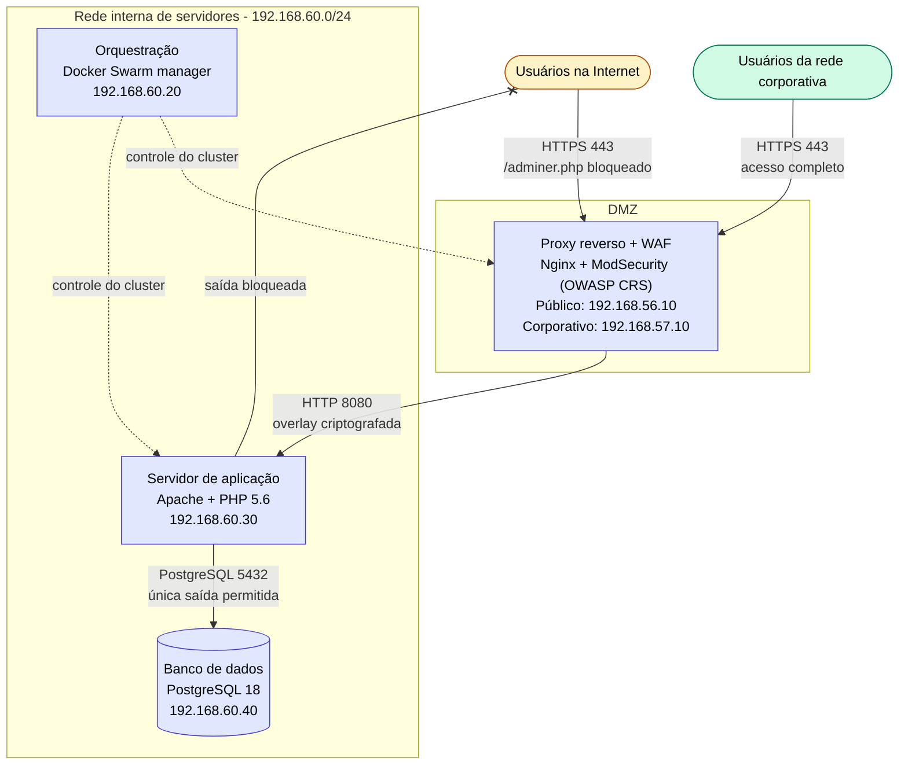

# Lab de Isolamento de Legado

Laboratório para rodar uma aplicação antiga de forma isolada, caso não seja possível atualizar a versão das tenologias envolvidas. A aplicação fica atrás de um WAF, sem acesso à internet e só consegue falar com o banco de dados.

O ambiente sobe 4 VMs no VirtualBox com Vagrant e é provisionado com Ansible.

## Visão na infraestrutura da empresa

O Vagrant é usado só para montar o laboratório. Numa infraestrutura real, o ambiente ficaria assim:



| Zona | O que fica nela | Quem acessa |
|---|---|---|
| Internet | Usuários externos | Só a DMZ, na porta 443 (a 80 redireciona) |
| Rede corporativa | Usuários internos da empresa | Só a DMZ, na porta 443 (a 80 redireciona) |
| DMZ | Proxy reverso com WAF | Encaminha para a aplicação pela overlay criptografada |
| Rede interna de servidores | Aplicação, banco e manager do Swarm | Não é acessível de fora. A aplicação só fala com o banco |

Em produção normalmente existe também um firewall de perímetro na frente da DMZ, fazendo o NAT do IP público. No laboratório essa função fica com o nftables de cada VM.

| VM | IP | Função |
|---|---|---|
| swarm-manager | 192.168.60.20 | Manager do Docker Swarm, faz o deploy da stack |
| dmz | 192.168.56.10 (público)<br>192.168.57.10 (corporativo)<br>192.168.60.10 (interna) | Proxy reverso com WAF |
| swarm-worker | 192.168.60.30 | Container da aplicação PHP |
| database | 192.168.60.40 | PostgreSQL |

A rede `192.168.60.0/24` é uma rede interna do VirtualBox e não é acessível pelo host. Do host só é possível acessar a DMZ.

## Segurança

- **DMZ**: só aceita 80 e 443 nos IPs de acesso. A porta 80 redireciona para https.
- **WAF**: todas as requisições passam pelo ModSecurity com as regras do OWASP CRS.
- **Rota pública**: além do WAF, bloqueia `/adminer.php` e `/_lib/prod` (retorna 404).
- **Rota corporativa**: acesso liberado a todos os caminhos.
- **Worker**: o container não tem acesso à internet. Só pode sair para o banco na porta 5432.
- **Banco**: só aceita conexão vinda do worker. Senha em md5 porque o PHP 5.6 não suporta scram.
- **PHP**: funções como `exec`, `system` e `shell_exec` desabilitadas e erros não aparecem na tela.
- **Swarm**: a rede overlay entre a DMZ e o worker é criptografada.

Todas as VMs usam nftables com política padrão de bloqueio.

### Como a aplicação sabe a rota de acesso (Apenas para visualizar no lab)

O Nginx envia o cabeçalho `X-Rota-Acesso` com o valor `publica` ou `corporativa`, conforme o IP acessado. O valor enviado pelo cliente é sempre sobrescrito pelo Nginx, então não dá para forjar.

```php
$rota = isset($_SERVER['HTTP_X_ROTA_ACESSO']) ? $_SERVER['HTTP_X_ROTA_ACESSO'] : '';
```

## Requisitos

- VirtualBox 7.x
- Vagrant 2.4+
- 8 GB de RAM livres (2 GB por VM)
- Acesso à internet no primeiro `vagrant up` (download do box, pacotes e imagens)

## Subindo o ambiente

```bash
vagrant up
```

A ordem é: manager, dmz, worker e database. O primeiro `vagrant up` demora alguns minutos por causa do build da imagem PHP.

Durante a subida é normal o serviço do WAF falhar algumas vezes até a DMZ terminar de provisionar. O Swarm tenta de novo sozinho.

Para conferir se os serviços estão rodando:

```bash
vagrant ssh swarm-manager -c 'sudo docker service ls'
```

Os dois serviços devem aparecer com `1/1` em `REPLICAS`.

## Acessando

| Rota | Endereço |
|---|---|
| Pública | https://192.168.56.10 |
| Rede corporativa | https://192.168.57.10 |
| Adminer (só pela rede corporativa) | https://192.168.57.10/adminer.php |

### Certificado

O certificado é autoassinado e vale para `legacy_app.local`, `192.168.56.10` e `192.168.57.10`. Para o navegador não mostrar aviso, copie o certificado e importe como autoridade confiável:

```bash
vagrant ssh dmz -c 'cat /opt/nginx/certs/legacy_app.crt' > legacy_app.crt
```

Testando com curl:

```bash
curl --cacert legacy_app.crt https://192.168.57.10/
```

### Banco de dados

| Campo | Valor |
|---|---|
| Sistema | PostgreSQL |
| Servidor | 127.0.0.1 ou localhost |
| Usuário | usuario |
| Senha | senha |
| Banco | legacy_app |

Dentro do container o banco pode ser acessado acessado por `127.0.0.1:5432`. Um socat encaminha para o PostgreSQL na VM database. Esse exemplo é para caso o banco de dados esteja atualmente na mesma VM da aplicação.

As credenciais ficam em `ansible/database.yml`. São só para o laboratório.

## Atualizando a aplicação

O código PHP fica em `app/src/` e é copiado para `/var/www/html` no build da imagem.

Depois de alterar o código:

```bash
vagrant ssh swarm-worker -c 'sudo docker build --network host -t legacy_app:local /vagrant/app/'
vagrant ssh swarm-manager -c 'sudo docker service update --force lab_legacy_app'
```

O `--force` é necessário porque a imagem tem sempre a mesma tag e o Swarm não percebe que ela mudou.

Mudanças no Nginx ou no certificado são aplicadas com:

```bash
vagrant provision dmz
```

## Executando os playbooks manualmente

O `vagrant provision` só executa o `ansible-playbook` dentro de cada VM. Também dá para rodar manualmente: o Ansible já fica instalado nas VMs e o projeto fica montado em `/vagrant`.

```bash
vagrant ssh dmz
cd /vagrant
sudo ansible-playbook -i localhost, -c local ansible/dmz.yml
```

Troque `dmz` e `dmz.yml` pela VM e pelo playbook desejados. Os playbooks podem ser executados várias vezes. Se nada mudou, terminam com `changed=0`.

Também é possível executar os playbooks remotamente, a partir de outra máquina com Ansible.

## Estrutura

```
.
├── Vagrantfile              # definicao das VMs e redes
├── ansible/
│   ├── manager.yml          # Swarm manager e deploy da stack
│   ├── dmz.yml              # Nginx/WAF, certificado e firewall da DMZ
│   ├── worker.yml           # build da imagem e firewall do worker
│   ├── database.yml         # PostgreSQL, usuario e banco
│   └── tasks/
│       └── interfaces.yml   # descobre o nome das interfaces pelo IP
└── app/
    ├── Dockerfile           # imagem PHP 5.6 + Apache
    ├── docker-compose.yml   # stack do Swarm (proxy-waf e legacy_app)
    ├── entrypoint.sh        # sobe o socat e o Apache
    └── src/                 # codigo da aplicacao
```

## Comandos úteis

```bash
# status das VMs
vagrant status

# logs da aplicacao (Apache)
vagrant ssh swarm-worker -c 'sudo docker logs -f $(sudo docker ps -qf name=lab_legacy_app)'

# logs do WAF (inclui os bloqueios do ModSecurity)
vagrant ssh dmz -c 'sudo docker logs -f $(sudo docker ps -qf name=lab_proxy-waf)'

# regras de firewall de uma VM
vagrant ssh dmz -c 'sudo nft list table inet filter'

# reprovisionar uma VM
vagrant provision dmz

# destruir tudo
vagrant destroy -f
```

## Observações

- O WAF também analisa as requisições do Adminer. Consultas SQL feitas por ele podem ser bloqueadas (403) pelas regras de SQL Injection do CRS. Os bloqueios aparecem nos logs do WAF.
- Como o acesso é feito por IP, a regra 920350 do CRS (Host com IP numérico) é registrada em todas as requisições. Sozinha ela não bloqueia, mas soma pontos com outros alertas.
- O Swarm não permite publicar uma porta em um IP específico. Por isso o acesso corporativo na 443 é redirecionado pelo nftables da DMZ para a porta 9443 do Nginx. A 9443 não pode ser acessada diretamente.
- O arquivo `worker_token` é gerado pelo manager no provisionamento e está no `.gitignore`.
